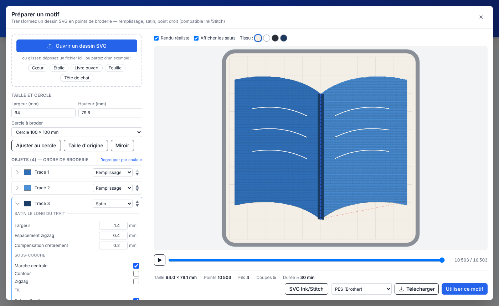

# Kit Brodeuse — biblio.gironde

Application web et de bureau (Windows, macOS, Linux) pour les ateliers broderie du réseau des bibliothèques de la Gironde.

Elle réunit deux outils :

1. **Préparer un motif** — un module de numérisation qui transforme un dessin vectoriel (SVG) en points de broderie, sur le modèle de l'extension [Ink/Stitch](https://inkstitch.org/) pour Inkscape, mais directement dans l'application, sans rien installer d'autre.
2. **Broder** — le pilotage de la brodeuse **Brother PP-1 SKiTCH** en Bluetooth (envoi du motif, traçage du cadre, suivi de la broderie et des changements de fil), repris de [Respira](https://github.com/jhbruhn/respira) de Jan-Henrik Bruhn.



## Utiliser l'application

- **En ligne** (Chrome, Edge ou Opera, pour le Bluetooth) : https://biblioGironde.github.io/Kit-Brodeuse
- **Application de bureau** : télécharger l'installateur dans les [Releases](https://github.com/biblioGironde/Kit-Brodeuse/releases/latest).

La préparation des motifs fonctionne dans tous les navigateurs récents, même sans brodeuse : on peut préparer chez soi et télécharger le fichier `.pes`.

### Déroulé d'un atelier

1. Cliquer sur **Ouvrir l'atelier de préparation**.
2. **Ouvrir un dessin SVG** (ou glisser-déposer), ou partir d'un exemple : cœur, étoile, livre ouvert, feuille, tête de chat.
3. Régler la **taille** (bouton *Ajuster au cercle* pour le cercle 100 × 100 mm ou 70 × 70 mm).
4. Pour chaque objet de la liste (dans l'ordre de broderie) : choisir le type de point et la couleur du fil, déplier ▸ pour les réglages fins. Survoler un objet le surligne dans l'aperçu.
5. Vérifier avec le **simulateur** (▶) : il montre la broderie point par point.
6. **Utiliser ce motif** l'envoie dans l'écran de la brodeuse (positionnement, rotation, envoi). Ou **Télécharger** au format PES, DST, JEF, EXP ou VP3 pour une autre machine.

### Préparer son dessin

- Formes **pleines** (avec remplissage) → *Remplissage* tatami.
- **Traits** épais (≥ 1,2 mm) → *Satin* ; traits fins → *Point droit*.
- Une forme avec remplissage **et** contour donne deux objets : le remplissage, puis le contour.
- Le **texte** doit être converti en chemins (Inkscape : *Chemin › Objet en chemin*) et les **images** vectorisées (*Chemin › Vectoriser un objet matriciel*).
- Pas de zone de moins de ~1 mm : la machine ne sait pas la broder proprement.

## Équivalences avec Ink/Stitch

Le module lit et écrit les mêmes paramètres qu'Ink/Stitch (attributs `inkstitch:*` dans le SVG). Un fichier préparé dans Inkscape + Ink/Stitch s'ouvre avec ses réglages ; le bouton **SVG Ink/Stitch** enregistre un SVG qui se rouvre ici ou dans Inkscape.

| Ink/Stitch | Kit Brodeuse | Paramètres repris |
| --- | --- | --- |
| Remplissage automatique (*auto_fill*) | Remplissage tatami | angle, espacement des rangs, longueur max., décalage, compensation, sous-couche (angle, espacement, retrait) |
| Colonne satin (*satin_column*, 2 rails) | Satin (2 rails) | espacement zigzag, compensation, sous-couches marche centrale / contour / zigzag |
| Trait zigzag (*zigzag_stitch*) | Satin le long du trait | largeur = épaisseur du trait |
| Point droit (*running_stitch*) | Point droit | longueur, répétitions, point triple (*bean stitch*) |
| Points d'arrêt, *trim_after* | Points d'arrêt, couper le fil après | — |

Non pris en charge pour l'instant : remplissages contour / guidé / méandre / circulaire (remplacés par un tatami, avec un avertissement), lettrage, points croisés, ripple, éléments `clone`. Pour ces cas, préparer le motif dans Inkscape + Ink/Stitch, exporter en `.pes` et l'ouvrir avec **Choose PES File**.

## Développement

```bash
npm ci
npm run web:dev          # webapp en local (http://localhost:5173)
npm run test:run         # tests
npm run electron:start   # application de bureau en développement
npm run electron:make    # installateurs pour le système courant
```

Organisation du module de préparation :

```
src/digitizer/
  svgDocument.ts   lecture du SVG : unités → mm, transformations, styles, paramètres inkstitch:*
  svgPath.ts       analyse de l'attribut d et aplatissement des courbes
  stitches/        générateurs de points : fill.ts (tatami), satin.ts, running.ts
  digitize.ts      planification : objets → blocs de couleur, liaisons, coupes, sérialisation
  svgExport.ts     export SVG compatible Ink/Stitch
  samples.ts       motifs d'exemple
src/components/Digitizer/   interface (dialogue, aperçu/simulateur, paramètres)
```

L'écriture des fichiers PES/DST/JEF/EXP/VP3 se fait avec la bibliothèque Python `pystitch` (celle d'Ink/Stitch), exécutée dans le navigateur par Pyodide — le même moteur que Respira utilise pour lire les PES.

## Publication (GitHub Actions)

- Chaque push sur `main` lance les tests, puis prépare une **release brouillon** avec les installateurs (Windows, macOS, Linux) et la webapp zippée.
- **Publier** la release (dans l'onglet Releases) déploie la webapp sur GitHub Pages ainsi que les fichiers de mise à jour automatique.
- Réglages du dépôt nécessaires : *Settings › Pages › Source : GitHub Actions* ; *Settings › Actions › General › Workflow permissions : Read and write*.
- Les numéros de version suivent les libellés des pull requests (`fix`, `feature`, `breaking`), voir `CLAUDE.md`.

## Licence et crédits

- Code sous licence **Apache 2.0** (voir `LICENSE.md`), comme Respira.
- Pilotage de la brodeuse : [Respira](https://github.com/jhbruhn/respira) © Jan-Henrik Bruhn. Le README d'origine est conservé dans `README.respira.md`.
- Le module de préparation est une réécriture indépendante en TypeScript : il ne reprend pas de code d'Ink/Stitch (GPL v3), seulement les noms de paramètres pour la compatibilité des fichiers. Merci au projet [Ink/Stitch](https://inkstitch.org/) et à sa bibliothèque `pystitch`.
- Pour garder le dépôt à jour avec Respira : `git remote add upstream https://github.com/jhbruhn/respira && git pull upstream main`.
